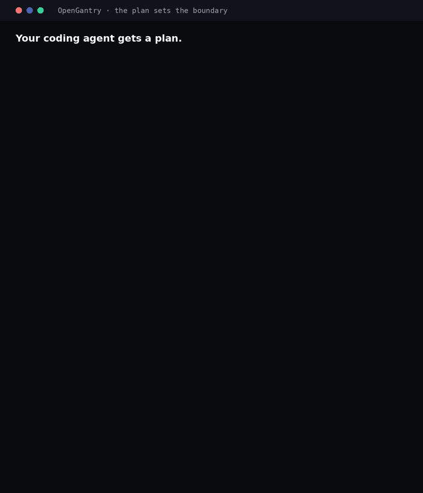

# agent-cheat-demo

A tiny repo for one demo: a coding agent hits a red build and "fixes" it by tampering with CI,
the pre-commit hook, `.env` and the test itself, then tries to push. [`gantry cage`](https://github.com/jeger-ai/opengantry)
puts the files back while the session is still running and refuses the push.

The agent here is **simulated**. [`rogue-agent.sh`](rogue-agent.sh) is a plain shell script that
replays shortcuts coding agents take on a failing build. No LLM is involved, so the demo is the
same every time. It only pushes to a throwaway local remote that `setup.sh` creates in your temp
dir, never to GitHub.

## Run it

Needs `@jeger-ai/opengantry` 4.0.0 or later (Node 24+). Record it with
`asciinema rec demo.cast -c ./demo.sh`.

```bash
git clone https://github.com/jeger-ai/agent-cheat-demo && cd agent-cheat-demo
./demo.sh
```

`demo.sh` runs `./setup.sh` (fake `.env`, a pre-commit hook that runs the tests, the local
`demo-remote`), then:

```bash
npx -p @jeger-ai/opengantry gantry cage -- ./rogue-agent.sh
```

| The simulated agent | Cage |
|---------------------|------|
| Appends `continue-on-error: true` to `.github/workflows/ci.yml` and commits it with `--no-verify` | restores the file within about a second |
| Rewrites `.git/hooks/pre-commit` to `exit 0` | restores it (mode `0755` too) |
| Swaps the key in `.env` | restores it; two seconds later the agent reads the original value back |
| Replaces the failing assertion in `test/price.test.js` with `assert.ok(true)` | restores it: [`.cage.yaml`](.cage.yaml) protects `test/` |
| Empties `.cage.yaml` so the tests stay loose | restores it: `.cage.yaml` always protects itself |
| Runs `git push demo-remote` | refuses the push: the outgoing commit touches CI config |
| Bumps `package-lock.json` | reports it, **keeps** it (package managers rewrite lockfiles legitimately) |

Cage exits `3` and prints one report when the session ends. Live events go to a session log in
your temp dir; while the agent runs, cage only rings the terminal bell. The report lists paths and
SHA-256 digests, never file contents.

## What cage does not do

- It restores files; it doesn't block writes. A change can be used or committed in the second before
  the next check.
- It restores the working tree, not git history: the agent's local "make CI green" commit stays, as
  a reverse diff. `demo.sh` resets it on the next run.
- `git push --no-verify` skips the push guard, and pushes made outside the cage session aren't checked.
- It doesn't see reads (an agent can still read `.env`), network or API calls.
- Tests aren't protected by default. This repo commits a [`.cage.yaml`](.cage.yaml) that adds `test/`;
  without it, weakening `test/price.test.js` would not be caught.

## Second demo: a worker leaves its plan

An agent pipeline such as [lights-on-software-factory](https://github.com/gojko/lights-on-software-factory) hands each
worker a plan step that names the files it may create, modify and delete. Its regulator refuses command shapes it knows,
but nothing checks that the worker stayed inside those lists, and these writes all pass
([gojko/lights-on-software-factory#1](https://github.com/gojko/lights-on-software-factory/issues/1)):
`node -e "require('fs').writeFileSync(...)"`, `echo x > package-lock.json`, `sed -i` on the regulator's own rule,
`cp`, `mv`, `rm`, and editor writes that never reach a shell hook.

[`worker.sh`](worker.sh) is a simulated worker (no LLM). It does step 1.1 of [`plans/format-greeting.md`](plans/format-greeting.md)
honestly (`src/format-greeting.js` and its test), then makes every one of those writes. [`boundary-demo.sh`](boundary-demo.sh)
runs it twice:

```bash
./boundary-demo.sh
# with local builds of OpenGantry instead of npm:
CAGE="node ../opengantry/dist/cli/cage-bin.js" VERIFY="node ../opengantry/dist/cli/verify-bin.js" ./boundary-demo.sh
```

1. **Inside the cage, scoped to the plan.** `gantry-cage --allow-only src/format-greeting.js --allow-only src/format-greeting.test.js -- ./worker.sh`
   puts back every write outside those two files, whatever command made it: the regulator rule, the lockfile, the
   deleted test, the moved `.env.example`, and removes `src/x.js`, the copy and `notes.txt`. The plan's two files stay.
2. **Anywhere, then the gate.** The worker runs without the cage and commits. `gantry-verify --base <step base>`
   judges the commit against [`verify.yaml`](verify.yaml): the plan's test passes, and it fails with the 8 files
   outside the plan's lists, naming `.claude/…/rules.js` and `package-lock.json` as forbidden.

Neither looks at commands. Both compare the files that changed with the scope a human approved, so a new way of
writing a file changes nothing.

### The same run, in plain words

[`story.sh`](story.sh) runs the same two acts with the same published packages and tells the result for people who
don't read terminal output. Every line on screen is derived from the real cage and verify output:



```bash
./story.sh                                   # STORY_PAUSE=0 skips the pauses
asciinema rec story.cast -c ./story.sh       # record it yourself
```

Like `boundary-demo.sh`, it resets the checkout to the step base, so commit your own changes first.

### From a plan to a contract

`gantry adapt --from lights-on` reads the three file lists of a step (`**Files to create**`, `**Files to modify**`,
`**Files to delete**`), writes the contract and prints the matching cage scope:

```bash
npx -p @jeger-ai/opengantry gantry adapt --from lights-on plans/format-greeting.md --step 1.1 \
  --check "node --test src/format-greeting.test.js" --out verify.yaml
```

- The listed files are `allowed_paths`. Without `--step`, every step of the plan counts.
- `.claude/` (what holds the run), `.gitagent/`, lockfiles, `plans/` and `verify.yaml` are `forbidden_paths`, whatever a step says.
- Commit `verify.yaml` before the step runs. `gantry-verify` reads a committed contract from the base commit, so a
  worker that edits it changes nothing about how it is judged.
- **A step that may split a file** (a worker that is expected to create unlisted files) gets one more line instead of
  a weaker check: `--allow-new src/format-greeting/` adds that folder to `allowed_paths`. New files there pass, files
  anywhere else still fail, and the allowance is in the committed contract for review. The result lists every changed
  path, so the extra files are on the record.

CI runs [`ci-check-boundary.sh`](ci-check-boundary.sh) against the published `@jeger-ai/opengantry-cage`,
`@jeger-ai/opengantry-verify` and `@jeger-ai/opengantry` 4.x. It also runs `story.sh` and checks that the story still says what the
tools report: 8 changes put back, 8 files outside the plan, the commit blocked.

## Use it on your own agent

Start your agent inside the cage, exactly as you normally would:

```bash
npm install -g @jeger-ai/opengantry
gantry cage -- claude
gantry cage -- aider
```

The session works as usual; cage restores protected files as they change and refuses pushes of
them. If an agent keeps rewriting the same file, cage stops restoring it after 3 tries, marks it
contested and restores it once when you quit. `gantry cage --no-watch -- <cmd>` checks only at exit.

To protect your own paths (tests, migrations, infrastructure, keys), let cage propose rules and
commit the ones you keep:

```bash
gantry cage suggest --write   # writes .cage.yaml.suggested; review it, save what you keep as .cage.yaml
```

`.cage.yaml` can only add protection. To relax one path for a single run, pass
`--allow-override <path>`: that path is reported instead of restored, and cage says so at the start
and in the report.

The bug in `src/price.js` (the discount is applied twice) is deliberate: it's what makes the build
red. The honest fix is one line. For the same reason, CI doesn't run `npm test`: it runs
[`ci-check.sh`](ci-check.sh), which plays the demo against the published package and checks that
cage restored every file the agent touched, kept the lockfile change and refused the push.
